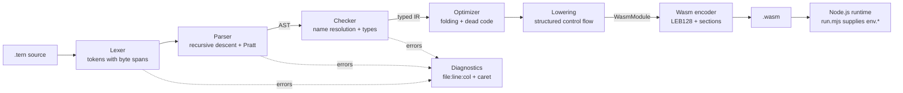

# swift-wasm-compiler

[](https://github.com/bhavana-sanal/swift-wasm-compiler/actions/workflows/ci.yml)
[](LICENSE)


**A compiler for Tern, a small statically typed language, that writes WebAssembly binaries byte by byte — written in Swift with no dependencies.**

Everything between the source text and the `.wasm` file is hand-written: the lexer, a recursive-descent parser with Pratt-style expressions, a type checker with rustc-style diagnostics, a constant-folding pass, and a binary encoder that emits LEB128 integers and Wasm sections directly. A small Node.js host runs the result.

```
$ ternc run examples/mandelbrot.tern
                   .........:::::::::::::::::::::::::::.................
                  .......:::::::::::::::::----=%*==---::::..............
                 .....:::::::::::::::::------==+%#*#=----::::...........
                ....::::::::::::::::-------===+*%%%#+=-----::::.........
               ...::::::::::::::::-------===+*%%%@%%%+==----:::::.......
              ..::::::::::::::::-------==+++*#%@@@@%%*+====--::::::.....
             ..:::::::::::::::------==+%%%#%%%%%@@@%%%%#***%=-::::::....
             .::::::::::::::---=====++*%%@%@@@@@@@@@@@@%%%%%%=-::::::...
            .::::::::::::--=======+++*%%%%@@@@@@@@@@@@@@@@@%+==-::::::..
            :::::::::---=%++++++++**#%%@@@@@@@@@@@@@@@@@@@%%#+=--::::::.
           .::::-----===+%%%%%%%%###%%@@@@@@@@@@@@@@@@@@@@@@%%=--::::::.
           ::------====+*#%%@%%@%%%%%@@@@@@@@@@@@@@@@@@@@@@@%*=--:::::::
           :------====+##%%%@@@@@@@%%@@@@@@@@@@@@@@@@@@@@@@@%+=---::::::
           -----++++**%%%%@@@@@@@@@@%@@@@@@@@@@@@@@@@@@@@@@%*==---::::::
           @@@@@@@@@@@@@@@@@@@@@@@@@@@@@@@@@@@@@@@@@@@@@@%%#+==---::::::
           ...
```

## Contents

- [Quickstart](#quickstart)
- [A tour of Tern](#a-tour-of-tern)
- [Command-line usage](#command-line-usage)
- [Architecture](#architecture)
- [Anatomy of a binary](#anatomy-of-a-binary)
- [Diagnostics](#diagnostics)
- [Optimizations](#optimizations)
- [Design decisions and trade-offs](#design-decisions-and-trade-offs)
- [Testing](#testing)
- [Limitations and what's next](#limitations-and-whats-next)

## Quickstart

You need a Swift 6 toolchain (Xcode 16+ on macOS, or the official toolchain on Linux). `ternc run` and the end-to-end tests also need [Node.js](https://nodejs.org) on your `PATH`.

```sh
git clone https://github.com/bhavana-sanal/swift-wasm-compiler.git
cd swift-wasm-compiler
swift build -c release

.build/release/ternc run examples/fizzbuzz.tern
.build/release/ternc build examples/primes.tern -o primes.wasm
.build/release/ternc build examples/primes.tern --emit wat -o primes.wat
```

## A tour of Tern

Tern looks like a pocket-sized Rust. A program is a list of functions; `export fn main()` is the entry point the runner calls.

```rust
// Functions have typed parameters and an optional return type.
// The last expression of a block, written without `;`, is its value.
fn fib(n: i32) -> i32 {
    if n < 2 { n } else { fib(n - 1) + fib(n - 2) }
}

export fn main() {
    print_i32(fib(20));      // 6765
    print_str("\n");
}
```

**Bindings and inference.** `let` is immutable, `var` is mutable. Types are inferred from the initializer, and integer literals take their type from context:

```rust
let width = 72;               // i32
var total: i64 = 0;           // the literal is typed i64 by the annotation
total = total + 3 * width as i64;
```

**Types.** `i32`, `i64`, `f64`, `bool`, `str` (string literals), and fixed-size arrays such as `[f64; 8]`. There are no implicit conversions; `as` converts between numeric types and from `bool` to an integer.

```rust
let ratio = (row as f64) / (height as f64);
let truncated = -3.99 as i32;         // -3: float-to-int casts truncate and saturate
```

**`if` is an expression,** and so is any `{ }` block:

```rust
fn label(n: i32) -> str {
    if n % 15 == 0 { "FizzBuzz" } else if n % 3 == 0 { "Fizz" } else { "Buzz" }
}

let squared = { let t = 7; t * t };
```

**Loops.** `while`, and `for` over a half-open integer range. `break` and `continue` work in both.

```rust
for i in 0..10 {
    if i % 2 == 0 { continue; }
    if i > 7 { break; }
    total += i;               // compound assignment: += -= *= /= %=
}
```

**Arrays** live in linear memory. They are created from a literal, indexed with a bounds check, and can be assigned element-wise when declared with `var`:

```rust
var composite = [false; 10000];     // repeat form
let shades = [" ", ".", ":", "-"];  // list form
composite[9] = true;
print_str(shades[2]);
```

**Host functions.** `print_i32`, `print_i64`, `print_f64` and `print_str` are imported from the host. None of them adds a newline.

### Operators

From lowest to highest precedence; all binary operators are left-associative.

| Precedence | Operators | Operand types |
| --- | --- | --- |
| 1 | `\|\|` | `bool`, short-circuiting |
| 2 | `&&` | `bool`, short-circuiting |
| 3 | `==` `!=` `<` `<=` `>` `>=` | numbers (`==`/`!=` also `bool`) |
| 4–6 | `\|`, then `^`, then `&` | integers |
| 7 | `<<` `>>` | integers (`>>` is arithmetic) |
| 8 | `+` `-` | numbers |
| 9 | `*` `/` `%` | numbers (`%` integers only) |
| 10 | `as` | numeric casts |
| 11 | unary `-` `!` | |

Bitwise operators bind tighter than comparisons (as in Rust, unlike C), so `flags & mask == 0` means `(flags & mask) == 0`.

### Runtime semantics

- **Integer overflow wraps** (two's complement) for `+`, `-` and `*` on both `i32` and `i64`; `2147483647 + 1` is `-2147483648`. This is what the Wasm instructions do, and the constant folder reproduces it exactly.
- **Integer division by zero traps**, as does `-2147483648 / -1`. Shift counts are taken modulo the bit width.
- **Out-of-bounds array indices trap** (negative indices included).
- **`f64` to integer casts saturate:** NaN becomes 0 and out-of-range values clamp to the type's minimum or maximum (`trunc_sat`), so a cast never traps.
- **Stack overflow traps.** Array storage lives on a 64 KiB stack; a frame that doesn't fit faults on its first access.

A trap stops the program; the runner keeps whatever was printed before it, reports the trap on stderr and exits with status 1:

```rust
export fn main() {
    let a = [1, 2, 3];
    let i = 3;
    print_str("before ");
    print_i32(a[i]);
}
```

```
$ ternc run oops.tern
before trap: unreachable
```

## Command-line usage

```
usage: ternc <command> <file.tern> [options]

commands:
  build <file> [-o <path>] [--emit wasm|wat]   compile to a Wasm binary (or text)
  check <file>                                 type-check and report diagnostics
  run <file>                                   compile and run main() under Node.js
```

- `build` writes `<file>.wasm` next to the source unless `-o` is given. `--emit wat` writes the text format instead, which is handy for reading what the compiler produced.
- `check` stops after type checking and exits with status 1 if there were errors.
- `run` compiles in memory, then runs the module with the bundled [`run.mjs`](Sources/TernCore/Resources/run.mjs) host, which calls `WebAssembly.validate` before instantiating it and forwards the program's exit status.

## Architecture



The package has two targets: the `TernCore` library, which holds the whole pipeline, and the thin `ternc` executable.

| Stage | Source | What it does |
| --- | --- | --- |
| Lexer | [`Syntax/Lexer.swift`](Sources/TernCore/Syntax/Lexer.swift) | Bytes to tokens, each with a byte-offset `Span`. Bad characters are reported and skipped. |
| Parser | [`Syntax/Parser.swift`](Sources/TernCore/Syntax/Parser.swift) | Recursive descent for items and statements, precedence climbing for binary operators. Errors throw to the nearest statement or item boundary, where the parser resynchronizes. |
| AST | [`Syntax/AST.swift`](Sources/TernCore/Syntax/AST.swift) | Value types throughout: structs for declarations, indirect enums with associated values for expressions and statements. |
| Checker | [`Semantics/Checker.swift`](Sources/TernCore/Semantics/Checker.swift) | Resolves every name to a local slot or function index, checks types bidirectionally, and produces the typed IR in [`TypedIR.swift`](Sources/TernCore/Semantics/TypedIR.swift). |
| Optimizer | [`Semantics/Optimizer.swift`](Sources/TernCore/Semantics/Optimizer.swift) | Constant folding and dead-code removal on the typed IR. |
| Lowering | [`Lowering/`](Sources/TernCore/Lowering) | Typed IR to a `WasmModule`: imports, function types, locals, stack frames for arrays, the string data segment. |
| Encoder | [`Wasm/`](Sources/TernCore/Wasm) | An in-memory module model, the binary encoder, LEB128, and a WAT printer for `--emit wat`. |
| Runtime | [`Runtime/NodeRunner.swift`](Sources/TernCore/Runtime/NodeRunner.swift) | Locates `node` and runs a module with the bundled host script. |

### Memory layout

Programs that use neither strings nor arrays get no memory section at all. A program with arrays gets this layout (without arrays, the stack is left out and strings start at address 0):

```
0                 65536                                  page boundary
├─── stack ◄──────┼─── string data ─────────────┤
     grows down     [u32 length][UTF-8 bytes]…
     from 65536
```

- **Arrays** are allocated in a per-function frame. The prologue subtracts the frame size from a mutable global `$sp`; every `return` and the normal exit add it back. Each array has a fixed offset inside the frame, so element access is `frame + index * size` plus a static `offset=` immediate on the load or store.
- **Strings** are interned into one data segment as a little-endian `u32` length followed by the bytes. A `str` value is just the `i32` address of that header, so it fits in a local, a parameter or an array slot.
- **Stack overflow** needs no explicit check: a frame that grows past address 0 wraps to a huge unsigned address, and its first access traps as out of bounds.

## Anatomy of a binary

This three-line program:

```rust
export fn main() {
    print_i32(6 * 7);
}
```

compiles to the following 61-byte module. `6 * 7` was folded to `42`, and because the program uses neither strings nor arrays there is no memory section.

```
00 61 73 6d                      magic: "\0asm"
01 00 00 00                      version 1

01 08                            type section, 8 bytes
   02                              2 entries
   60 01 7f 00                     0: (func (param i32))        print_i32
   60 00 00                        1: (func)                    main

02 11                            import section, 17 bytes
   01                              1 entry
   03 65 6e 76                     module "env"
   09 70 72 69 6e 74 5f 69 33 32   name "print_i32"
   00 00                           a function of type 0

03 02                            function section, 2 bytes
   01 01                           1 function, of type 1

07 08                            export section, 8 bytes
   01                              1 entry
   04 6d 61 69 6e                  name "main"
   00 01                           function index 1 (index 0 is the import)

0a 08                            code section, 8 bytes
   01                              1 body
   06                              body size: 6 bytes
   00                              no locals
   41 2a                           i32.const 42
   10 00                           call 0
   0b                              end
```

Every count and size above is an unsigned LEB128; constants such as `i32.const` use signed LEB128, which is why the encoder tests pay special attention to values like `64` (`c0 00`, not `40`).

## Diagnostics

Errors carry a span, are rendered with the offending line and a caret underline, and the checker keeps going after the first one. An error type absorbs follow-on mistakes, so one typo produces one message. This is the real output of `ternc check demo.tern`:

```
error: mismatched types: expected 'f64', found 'i32'
 --> demo.tern:2:5
  |
2 |     total / count
  |     ^^^^^^^^^^^^^

error: cannot find 'cuont' in scope
 --> demo.tern:9:9
  |
9 |         cuont += 1;
  |         ^^^^^
  = help: did you mean 'count'?

error: cannot assign to immutable variable 'limit'
  --> demo.tern:11:5
   |
11 |     limit = 20;
   |     ^^^^^
   = help: declare it with 'var' to make it mutable

error: function 'average' takes 2 arguments but 1 was given
  --> demo.tern:12:15
   |
12 |     print_f64(average(count));
   |               ^^^^^^^^^^^^^^

warning: unreachable code
  --> demo.tern:14:5
   |
14 |     print_str("done\n");
   |     ^^^^^^^^^^^^^^^^^^^

error: could not compile 'demo.tern' due to 4 errors
```

"Did you mean" suggestions use the optimal string alignment distance (Levenshtein plus adjacent transpositions, so `cuont` is one edit from `count`) over the names in scope, the functions, the builtins or the type names, depending on what was misspelled.

The parser recovers too: after an error it skips to the next `;`, the end of the block or the next statement keyword, so a missing semicolon and a broken expression further down are both reported in one run. Type checking only runs once the program parses cleanly, since checking a half-parsed tree mostly produces noise.

## Optimizations

The optimizer works on the typed IR, between checking and lowering:

- **Constant folding** of unary, binary, comparison and logical operators and of casts, with the exact semantics of the Wasm instruction it replaces: wrapping arithmetic, masked shift counts, saturating float-to-int casts.
- **Trap preservation.** `1 / 0`, `5 % 0` and `-2147483648 / -1` are deliberately left unfolded, so they trap at run time exactly as the unoptimized program would.
- **Short-circuit simplification:** `true && x` becomes `x`, `false && x` becomes `false`, and likewise for `||`.
- **Branch and loop elimination:** an `if` with a constant condition is replaced by the branch it takes, and `while false` disappears along with branches that fold to nothing.
- **Dead code after `return`, `break` and `continue`** is dropped (the checker also warns about it).
- During lowering, `while true` is emitted without a condition check, and a `for` loop with a constant upper bound compares against an immediate instead of a temporary local.

Folding deliberately stops at variables: there is no constant propagation, so `let x = 2; x * 3` stays a multiplication.

## Design decisions and trade-offs

- **A typed IR instead of lowering straight from the AST.** The checker resolves names to slot numbers and attaches a type to every node, so the optimizer and the lowering never repeat a lookup or re-derive a type. The cost is a second set of node types; the benefit is that lowering is a mechanical switch with no error paths.
- **Bidirectional type checking.** An expected type flows down as a hint and the synthesized type flows back up. That is enough to type `let x: i64 = 5` and `3 * n` (with `n: i64`) without full inference, and keeps every mismatch reported at a precise span.
- **Structured control flow maps one to one.** Wasm has no `goto`, but Tern has no unstructured jumps either: `while` becomes `block`+`loop`, `break`/`continue` become `br` with depths computed from a stack of open labels, and a `for` loop wraps its body in an inner `block` so that `continue` still runs the increment.
- **Arrays on a shadow stack, not a heap.** Fixed-size arrays with static frame offsets give array support without an allocator or garbage collector. The price is that arrays can't be passed to or returned from functions, which the checker reports as an error rather than silently copying.
- **Length-prefixed strings in a data segment.** A `str` is a single `i32`, so strings flow through locals, parameters and arrays with no special cases; the host reads the length from memory.
- **No dependencies.** Even the CLI parses its own arguments. Everything compiles with a stock Swift 6 toolchain, and the library has no platform-specific code, so the same sources build on macOS and Linux.
- **Swift 6 language mode.** The tree is made of `Sendable` value types and the passes are pure functions or short-lived structs with mutating methods, so strict concurrency checking has nothing to complain about.

## Testing

```sh
swift test
```

The suites, using Swift Testing:

| Suite | Covers |
| --- | --- |
| `LexerTests` | Tokens, longest-match operators, ranges vs. floats, string escapes, spans, error recovery |
| `ParserTests` | Precedence and associativity (as S-expressions), statements, spans, recovery at statement and item boundaries |
| `CheckerTests` | Accepted programs, and rejected ones with their exact messages or fully rendered diagnostics |
| `OptimizerTests` | Folding with wrap-around and saturation, trap preservation, short-circuiting, dead-code removal |
| `LEB128Tests` | Unsigned and signed encodings at every 7-bit boundary, including `Int64.min`/`max`, plus a round trip through an independent decoder |
| `WasmEncoderTests` | A byte-exact minimal module, section order and sizes, instruction encodings, local run-length encoding, WAT output |
| `EndToEndTests` | Compiles every program in `examples/`, runs it under Node and compares stdout with its `.expected` file; also runtime semantics such as wrapping, short-circuiting, casts and traps |

The end-to-end suite is skipped, with a message saying so, when `node` is not on `PATH`. Every module it runs passes through `WebAssembly.validate` in the runner first. CI runs the build (with warnings as errors) and the tests on macOS and on Linux.

## Limitations and what's next

Tern is intentionally small. Things it does not do yet:

- **Aggregates beyond fixed arrays.** No structs, and arrays can't cross function boundaries. Structs would fit the existing frame layout; passing arrays needs either copy semantics or borrowed references.
- **Heap allocation and GC.** There is no allocator, so nothing outlives its stack frame. The natural next step is the Wasm GC proposal's struct and array types, which would avoid writing a collector at all.
- **Closures and first-class functions.** These need `call_indirect`, a table, and closure conversion for captured variables.
- **WASI.** The output depends on four `env` imports supplied by the Node host. Targeting WASI's `fd_write` would let the same binaries run under wasmtime or wasmer.
- **Smaller output.** Every bounds check gets its own temporary local, and there is no constant propagation or register allocation of locals. A `name` custom section and source maps would also make debugging in a browser nicer.
- **Strings are opaque.** They can be stored and printed, but not compared, concatenated or indexed.
- **Diagnostic columns count UTF-8 bytes**, so the caret drifts on lines with non-ASCII text before the error.

## Project layout

```
Sources/
  TernCore/
    Syntax/       SourceFile, Diagnostic, Token, Lexer, AST, Parser
    Semantics/    TernType, TypedIR, Checker, Optimizer
    Lowering/     CodeGenerator, FunctionLowering
    Wasm/         WasmModule, Instruction, LEB128, BinaryEncoder, WatPrinter
    Runtime/      NodeRunner
    Resources/    run.mjs
    Compiler.swift
  ternc/          command-line entry point
Tests/TernCoreTests/
examples/         *.tern programs and their *.expected output
```

## License

[MIT](LICENSE) © 2026 Bhavana Sanal
